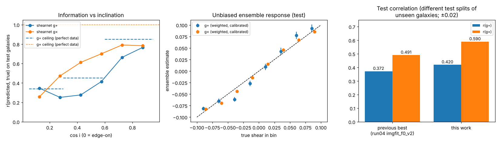
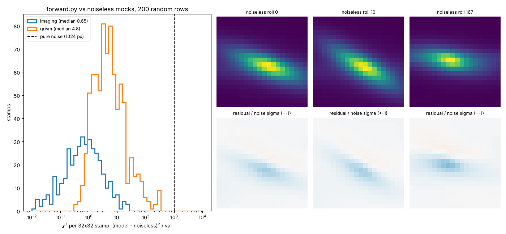

# shearnet: simulation-trained shear regression for the Roman KL mocks (v3, line SNR x10)

Predicts the galaxy-frame shear `truth.g_plus`, `truth.g_cross` **and a calibrated
per-galaxy uncertainty** from the six Roman stamps (F129, F158, 4 grism rolls) of
`kl_roman_nn_v3_lsnr10x`.

The design differs from the earlier `train_kl_grism*.py` runs in one main way:
**most of the training data are simulations from a forward model that was rebuilt
to reproduce the mock renderer** (validated pixel by pixel against the noiseless
stamps). The real training rows are mixed in at 15-20% of each batch.

## Results (held-out test set: 2,073 rows of galaxies never seen in training or simulations)



| | r(g+) | r(g×) | sigma_eff g+ | sigma_eff g× |
|---|---|---|---|---|
| previous best, `run04/imgfit_f0_v2` (its own 1,320-row test split) | 0.372 | 0.491 | ~0.145 | ~0.10 |
| shearnet, real data only (E1) | 0.19 | ~0 | | |
| shearnet, 60k sims from an imperfect forward model (E3) | 0.385 | 0.510 | 0.116 | 0.060 |
| shearnet, 120k sims from the validated forward model (E5) | 0.416 | 0.580 | 0.098 | 0.046 |
| **shearnet ensemble E5 + E6 (E6: 240k sims), released** | **0.420** | **0.590** | **0.097** | **0.044** |

`sigma_eff` is the effective per-galaxy shear noise of the de-shrunk,
inverse-variance-weighted, validation-calibrated estimator, computed from the
actual test residuals: N galaxies measure the mean shear to
`sigma_eff / sqrt(N)`. For comparison, conventional shape-noise weak lensing has
about 0.26 per component. The earlier models' values are estimated from their r
(no per-galaxy uncertainty was available). For a fixed shear S/N, this model
needs about 2.2x (g+) and 5.2x (g×) fewer galaxies than the previous best.

After calibration on the validation galaxies, the test biases are consistent with zero:
m(g+) = +0.014 ± 0.036, m(g×) = +0.025 ± 0.016, and |c| < 0.002 (released
ensemble). The predicted per-galaxy sigma is calibrated (pull standard deviation 0.91-1.04).

By inclination (test, r):

| cos i | g+ | g× | oracle g+ ceiling |
|---|---|---|---|
| 0.05-0.3 (edge-on) | 0.33 | 0.31 | 0.34 |
| 0.3-0.6 | 0.29 | 0.63 | 0.45 |
| 0.6-0.95 (face-on) | 0.66 | 0.79 | 0.85 |

**What to expect.** g+ is close to its physical limit for edge-on disks. Overall
it reaches about 75% of the perfect-data ceiling (0.42 vs 0.56). The headroom
left is mostly in g× for inclined disks and in g+ for face-on disks. Further
gains from more simulations are flattening: going from 120k to 240k sims improved
validation MSE by only 0.4%. A larger network trained on a GPU, or a likelihood
fit with `forward.py` as a benchmark, are the remaining options. Per-galaxy R^2 cannot approach 1 for g+ on this data set.
Judge the model by sigma_eff and the calibration (m, c), not by R^2.

Experiment log (all evaluated on the same validation/test galaxies):

* E1: canonical CNN on real rows only. Memorises the 3,014 galaxies;
  r(g+) peaks at 0.19, g× is never learned.
* E2: + 60k sims (old forward model), no kinematic inputs. g+ improves, g× still ~0.
* E3: + kinematic channels/statistics. g× learned (0.51 test). On held-out
  sims r(g×) = 0.60 vs 0.49 on real, which revealed a sim-to-real gap.
* Fixing the forward model (velocity field centred on the stamp origin; wider
  continuum) cut the grism chi^2 by 17x. The gap closed: E4 gives held-out sims
  0.373/0.522 and real 0.373/0.544.
* E4 (60k corrected sims) gives test 0.405 / 0.556. E5 (120k corrected sims, 20% real)
  gives test 0.416 / 0.580. An E4+E5 ensemble is equal on test (0.418 / 0.578) but
  inherits a small g+ additive bias from E4, so it was not used.
* E6: E5 fine-tuned on 240k corrected sims (A+B+C+D), validation MSE 0.777 vs 0.780.
  The E5 + E6 ensemble was best on validation (r 0.381 / 0.564) and is the released
  model: test 0.420 / 0.590, sigma_eff 0.097 / 0.044.


## Why the earlier models stalled (diagnosis)

1. **g+ has a hard physical ceiling.** For a thin disk, a shear along the major
   axis is exactly degenerate with inclination in both the image shape and the
   velocity-field shape. Only the Tully-Fisher prior on v_circ (0.049 dex
   scatter) and the disk thickness break it. With *perfect, noiseless*
   observables (`oracle_ceiling.py`) the best possible correlation is
   r(g+) = 0.56 overall: 0.85 for cos i > 0.6, 0.45 for 0.3-0.6, and 0.34 for
   edge-on. No network can beat this on the v3 data.
   g_x has no such degeneracy (oracle r = 1.0). It is limited by noise and resolution.
2. **Data volume, not architecture, limited the networks.** The 13,481 rows hold
   only 3,014 distinct galaxies. A CNN trained on the real rows memorises them
   (train MSE 0.60 vs val 1.07 after 30 epochs, even with fresh noise every
   epoch) and never learns g_x. The hand-built kinematic preprocessing in
   `train_kl_grism_v3.py` was compensating for this.
3. **The fix is unlimited simulated galaxies.** `forward.py` re-implements the
   mock renderer. Each simulation reuses the physical parameters of a training
   galaxy but redraws orientation, shear, centroids, rotation speed (around the
   TF prior) and noise. So the network sees each galaxy in many configurations
   and cannot memorise the shear.

## Forward model (`forward.py`), validated against the noiseless stamps

Reverse-engineered conventions, each confirmed by chi^2 against `img.*_clean`
(chi^2 per stamp summed over 32x32 pixels with the stored variance; pure noise gives about 1024):

| component | convention | chi^2 per stamp |
|---|---|---|
| imaging | GalSim `InclinedExponential` (sech^2 thickness h/r), rotated by theta_int, sheared by (g1, g2), shifted, Roman WFI PSF SCA 10 (pupil_bin 4, band effective wavelength) | 0.1-15 |
| grism geometry | stamp j = sky rotated by **-roll_j**; dispersion +x, 1.1 nm/px, centred on Halpha (vacuum 656.461 nm) at z | |
| kinematics | thin disk, v_los = v0 + vcirc (2/pi) arctan(R/r_v) sin i cos(phi), velocity field **centred on the stamp origin** (not the Halpha centroid; this was the largest mismatch) | |
| line | Gaussian line profile (truth.Halpha.dispersion), amplitude x0.93 | |
| continuum | flat f_lambda over +-20 px (+-22 nm) of the line, amplitude x0.95 | |
| grism, 200 random rows | per stamp: median 4.8, mean 14.6, 95th percentile 59 (about 1.4% of the noise variance on average) | |

`validate_forward.py` and `forward_validation_figure.py` reproduce these checks.



## Model (`train2.py`, `canon.py`, `kinfeat.py`)

* **Canonical frame**: the photometric position angle is measured from windowed
  moments of the imaging, and every stamp is rotated so the major axis lies
  along +x (grism stamp j by -(PA - roll_j)). The dispersion direction in that
  frame is passed as a scalar input.
* **Inputs (12 channels)**: canonical F129/F158, canonical continuum-subtracted
  grism (4), raw grism (4), and two **opposite-roll difference maps**
  (roll 0 - roll 177, roll 10 - roll 167). In these the continuum cancels and the
  rotation dipole survives.
* **Scalars**: z, Tully-Fisher prior mean, observed mass/line flux/band fluxes
  (observable catalogue values only, never truths), plus 10 moment-based
  kinematic statistics (`kinfeat.py`): the velocity-gradient vector solved from
  how each roll's second moments shear along its dispersion direction, and its
  angle to the photometric axis.
* **Network**: ResNet (6 blocks, 32-64-128 channels) with 3x3 spatial pooling,
  then an MLP. Outputs are the mean (g+, gx), log sigma, and 7 auxiliary truths
  (cos i, spin-2 PA, v sin i, sky g1/g2, h/r).
* **Loss**: MSE on the mean; Gaussian NLL for sigma on a detached mean (the
  uncertainty head cannot bias the estimate); auxiliary smooth-L1 with weight 0.3.
* **Every example gets fresh noise** each time it is drawn:
  `clean + sqrt(sigma_bkg^2 + clean/gain) * N(0,1)`.
* Validation and test use the provided noisy stamps of galaxies (split by
  `pop.id`) that appear in no training set and whose parameters are never used
  to make training simulations.

## Using the outputs in a shear pipeline

The network returns the **posterior mean** under the training prior (uniform
|g| < 0.1). It is shrunk toward 0 where the data are weak, which is why the
raw response (1+m) is 0.2-0.3. Do not average raw predictions as a shear
estimate. Use either:

* **De-shrunk per-galaxy estimate** (the one to use for an ensemble shear):
  `R = 1 - sigma^2 / sigma_prior^2` with `sigma_prior^2 = 0.1^2/3`;
  `g_hat = pred / R` with variance `sigma^2 / R`. Weight by `R / sigma^2`.
  On the test set its weighted response is about 0.9 (one global factor,
  calibrate on validation or simulations) and its pulls have std about 1.0.
* or the raw posterior mean plus a global response measured on simulations.

The per-galaxy sigma is calibrated (pull std 1.0-1.07 on test). Most of the
information comes from galaxies with cos i > 0.6, so weighting matters.

## Files

| file | purpose |
|---|---|
| `prep_data.py` | parquet -> `noisy/clean/var.npy` + scalar table |
| `oracle_ceiling.py` | information ceiling from perfect noiseless observables |
| `forward.py`, `validate_forward.py`, `make_psf_table.py` | forward model, chi^2 validation, PSF kernel table |
| `gen_sims.py` | simulated training sets (`--split train` only for training) |
| `canon.py`, `kinfeat.py` | canonicalisation, kinematic channels and statistics |
| `train2.py` | training (sims + real, fresh noise, EMA, sigma head) |
| `evaluate.py`, `eval_sims.py` | pipeline metrics and plots; sim-domain evaluation |
| `predict_split.py`, `calibrate.py` | val/test predictions; validation calibration of the de-shrunk estimator |
| `summary_figure.py`, `forward_validation_figure.py` | figures in this README |
| `predict.py` | inference / ensembling for new data -> CSV of g+, gx, sigma |
| `common.py`, `train.py` | shared utilities; `train.py` = first plain-CNN baseline |

## Released model

The released model is the ensemble of `models/shearnet_E5.pt` and
`models/shearnet_E6.pt` (self-contained checkpoints: weights, input
normalisation, roll angles, noise levels). `models/shearnet_ensemble_calibration.json`
holds its validation calibration (`shearnet_E5_calibration.json` is for E5 alone), and `models/psf_os5.npz` holds the precomputed
Roman PSF kernels used by the simulator.

```bash
python predict.py --ckpt models/shearnet_E5.pt models/shearnet_E6.pt \
    --calib models/shearnet_ensemble_calibration.json \
    --parquet new_galaxies.parquet --out shear_pred.csv
```

Columns `g_plus`, `g_cross`, `sigma_*` are the posterior mean and posterior
sigma. `ghat_*`, `sigma_ghat_*` are the de-shrunk, calibrated per-galaxy
estimates. Always combine them with weights `1/sigma_ghat^2`: uninformative
galaxies get huge `sigma_ghat` and negligible weight. The model was trained for
the v3 x10 grism depth, shear |g| < 0.1 and the v3 selection. Other depths or
priors need new simulations (`gen_sims.py`) and retraining.

## Reproduce

```bash
python prep_data.py --parquet kl_roman_nn_v3_lsnr10x.parquet --outdir DATA
python make_psf_table.py DATA/../psf_os5.npz
python gen_sims.py --data DATA --out SIMS_A --n 60000 --seed 11      # about 35 min on 4 CPU cores
python gen_sims.py --data DATA --out SIMS_B --n 60000 --seed 12
# what produced E5: E3 (old sims, 30 ep) -> E4 (SIMS_A, 20 ep, best at ep 5) -> E5 (A+B, 16 ep).
# From scratch, a single run on A+B is the simplest equivalent:
python train2.py --data DATA --sims SIMS_A SIMS_B --real_frac 0.2 --kin --epochs 40 --steps_per_epoch 500 --out RUN
python predict_split.py --ckpt RUN/model.pt --out RUN && python calibrate.py RUN && python evaluate.py RUN
python predict.py --ckpt RUN/model.pt --parquet new.parquet --out pred.csv
```

Several scripts default to the paths used in development (`/home/user/data/...`);
pass `--data`, `--psf_table` etc. explicitly. Training on 4 CPU cores takes
about 100 s per 500-step epoch; a GPU will be much faster.

Dependencies: numpy, pandas, pyarrow, torch (CPU is fine), galsim (Roman PSF),
scipy, scikit-learn, lightgbm, matplotlib.
